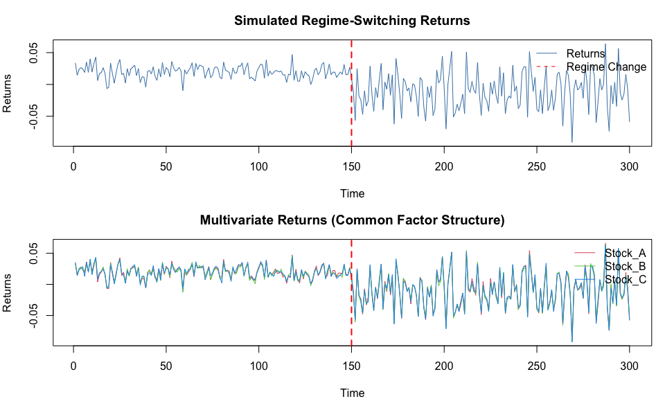
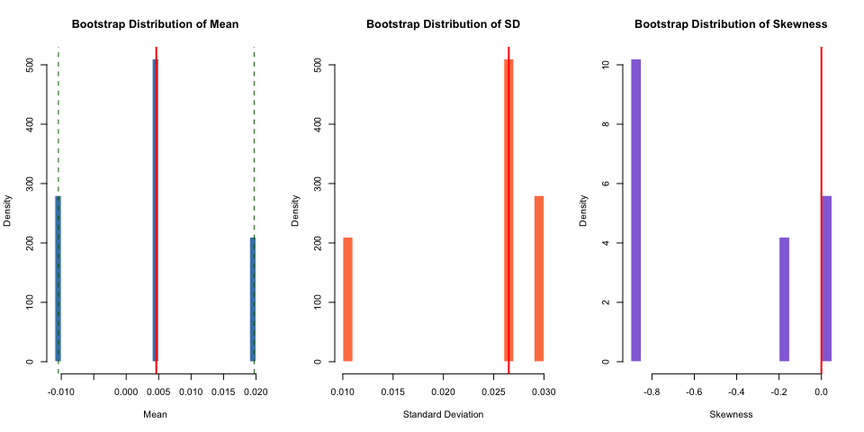
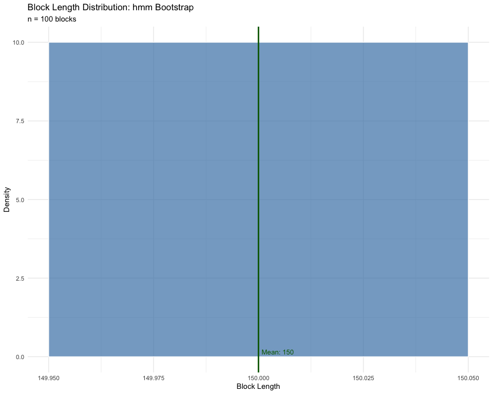
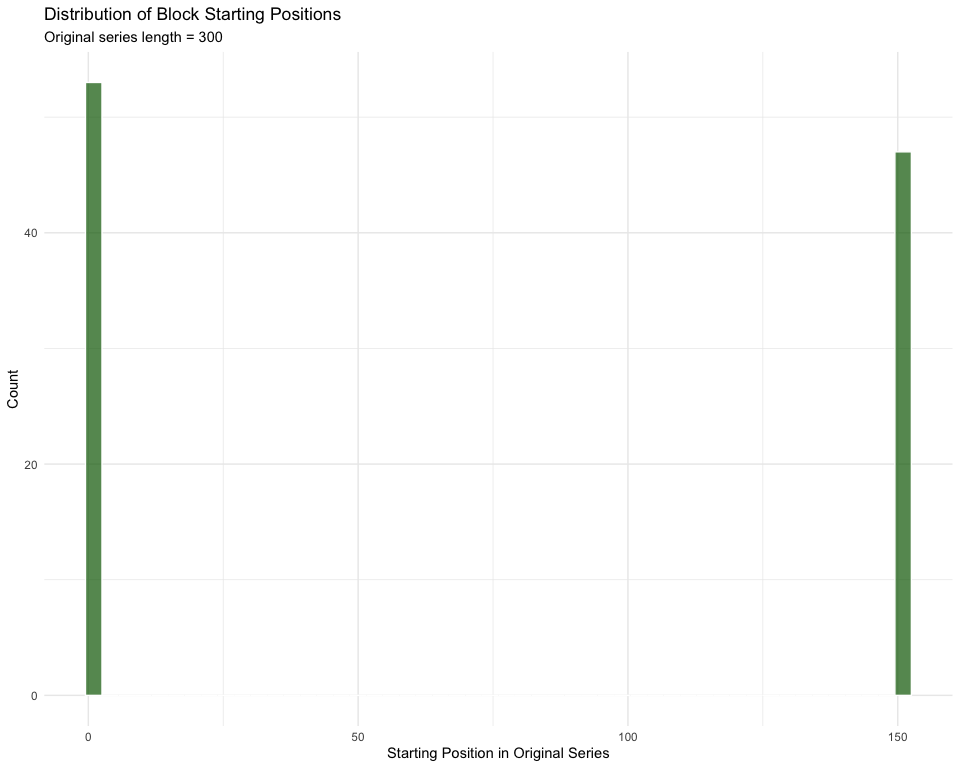
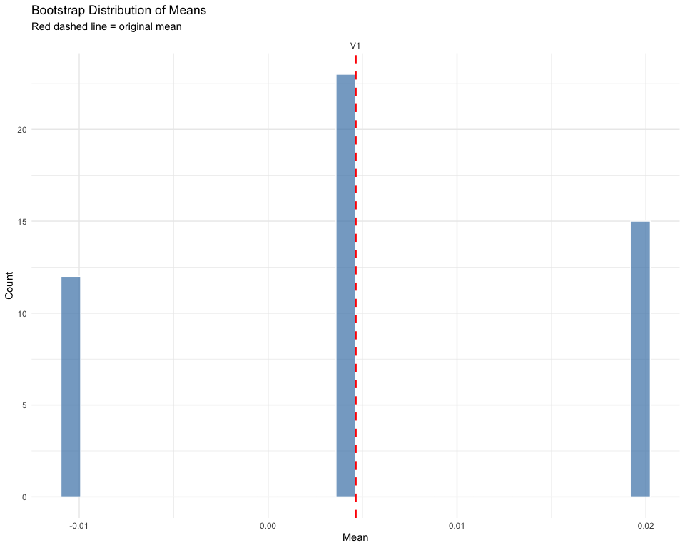
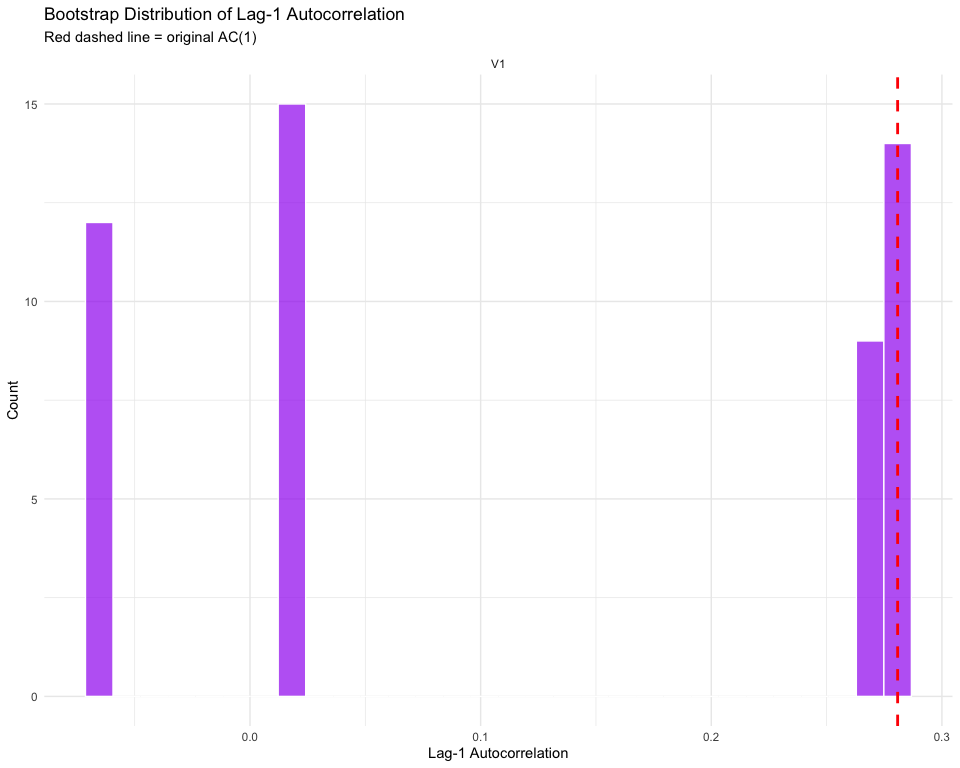
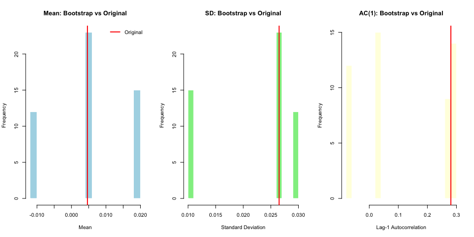
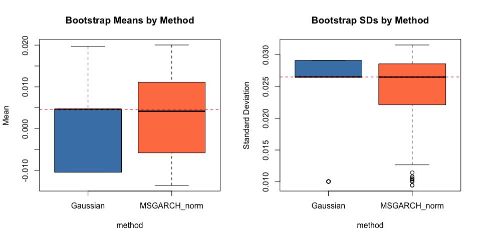
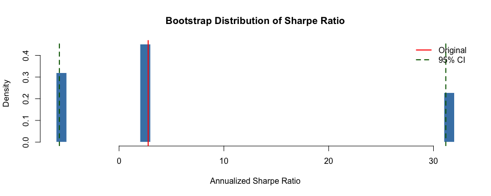

## Overview

This vignette demonstrates how to use `tsbs()` with `bs_type = "hmm"` for 
Hidden Markov Model bootstrap of financial time series. The HMM bootstrap is 
particularly useful for data exhibiting regime-switching behavior, such as:

- Bull/bear market cycles
- High/low volatility regimes
- Different economic states

The extended HMM bootstrap in tsbs supports:

1. **Gaussian HMM** (default) - Original behavior via depmixS4
2. **MSGARCH-based HMM** - GARCH dynamics with flexible distributions
3. **Raw HMM** - Non-Gaussian emissions without GARCH

## Setup


``` r
library(tsbs)
library(ggplot2)

# Check optional dependencies
has_msgarch <- requireNamespace("MSGARCH", quietly = TRUE)
has_fgarch <- requireNamespace("fGarch", quietly = TRUE)
has_depmix <- requireNamespace("depmixS4", quietly = TRUE)

cat("Available backends:\n")
```

```
## Available backends:
```

``` r
cat("- depmixS4 (Gaussian HMM):", has_depmix, "\n")
```

```
## - depmixS4 (Gaussian HMM): TRUE
```

``` r
cat("- MSGARCH (GARCH + flexible distributions):", has_msgarch, "\n")
```

```
## - MSGARCH (GARCH + flexible distributions): TRUE
```

``` r
cat("- fGarch (raw HMM with skew-t):", has_fgarch, "\n")
```

```
## - fGarch (raw HMM with skew-t): TRUE
```

## Simulating Regime-Switching Data

We create test data with clear regime structure - a common pattern in financial 
markets with distinct bull and bear regimes.


``` r
# Use parameters known to work well with MSGARCH estimation
set.seed(42)
n <- 300
n1 <- 150
n2 <- 150

# Gaussian regime-switching returns
# State 1 (Bull): Positive drift, low volatility
# State 2 (Bear): Negative drift, high volatility
y_returns <- c(
  rnorm(n1, mean = 0.02, sd = 0.01),
  rnorm(n2, mean = -0.01, sd = 0.03)
)

# Multivariate data with common market factor
set.seed(42)
k <- 3
market_factor <- c(
  rnorm(n1, mean = 0.02, sd = 0.01),
  rnorm(n2, mean = -0.01, sd = 0.03)
)
Y_multi <- matrix(0, nrow = n, ncol = k)
for (j in 1:k) {
  Y_multi[, j] <- market_factor + rnorm(n, sd = 0.002)
}
colnames(Y_multi) <- c("Stock_A", "Stock_B", "Stock_C")
```


``` r
par(mfrow = c(2, 1), mar = c(4, 4, 3, 1))

# Univariate returns
plot(y_returns, type = "l", col = "steelblue",
     main = "Simulated Regime-Switching Returns",
     xlab = "Time", ylab = "Returns")
abline(v = n1, col = "red", lty = 2, lwd = 2)
legend("topright", c("Returns", "Regime Change"), 
       col = c("steelblue", "red"), lty = c(1, 2), bty = "n")

# Multivariate returns
matplot(Y_multi, type = "l", lty = 1, col = 2:4,
        main = "Multivariate Returns (Common Factor Structure)",
        xlab = "Time", ylab = "Returns")
abline(v = n1, col = "red", lty = 2, lwd = 2)
legend("topright", colnames(Y_multi), col = 2:4, lty = 1, bty = "n")
```



``` r
par(mfrow = c(1, 1))
```

## 1. Basic Gaussian HMM Bootstrap

The default `distribution = "gaussian"` uses depmixS4 for HMM fitting. This is 
the original behavior and requires only the depmixS4 package.


``` r
# Basic HMM bootstrap with Gaussian emissions
result_gaussian <- tsbs(
  x = y_returns,
  bs_type = "hmm",
  num_states = 2,
  num_boots = 100,
  func = mean  # Compute mean of each replicate
)
```

```
## converged at iteration 19 with logLik: 789.9895
```

``` r
cat("Number of bootstrap replicates:", length(result_gaussian$bootstrap_series), "\n")
```

```
## Number of bootstrap replicates: 100
```

``` r
cat("Length of each replicate:", nrow(result_gaussian$bootstrap_series[[1]]), "\n")
```

```
## Length of each replicate: 300
```

### Analyzing Bootstrap Results


``` r
# Extract statistics from bootstrap replicates
boot_means <- sapply(result_gaussian$bootstrap_series, mean)
boot_sds <- sapply(result_gaussian$bootstrap_series, sd)
boot_skews <- sapply(result_gaussian$bootstrap_series, function(x) {
  mean((x - mean(x))^3) / sd(x)^3
})

# Summary statistics
cat("\nBootstrap Mean Distribution:\n")
```

```
## 
## Bootstrap Mean Distribution:
```

``` r
cat("  Original mean:", round(mean(y_returns), 5), "\n")
```

```
##   Original mean: 0.00463
```

``` r
cat("  Bootstrap mean of means:", round(mean(boot_means), 5), "\n")
```

```
##   Bootstrap mean of means: 0.00358
```

``` r
cat("  Bootstrap SE of mean:", round(sd(boot_means), 5), "\n")
```

```
##   Bootstrap SE of mean: 0.01055
```

``` r
cat("  95% CI:", round(quantile(boot_means, c(0.025, 0.975)), 5), "\n")
```

```
##   95% CI: -0.01044 0.01971
```

``` r
# Visualize
par(mfrow = c(1, 3))

hist(boot_means, breaks = 25, col = "steelblue", border = "white",
     main = "Bootstrap Distribution of Mean", xlab = "Mean", probability = TRUE)
abline(v = mean(y_returns), col = "red", lwd = 2)
abline(v = quantile(boot_means, c(0.025, 0.975)), col = "darkgreen", lty = 2)

hist(boot_sds, breaks = 25, col = "coral", border = "white",
     main = "Bootstrap Distribution of SD", xlab = "Standard Deviation", probability = TRUE)
abline(v = sd(y_returns), col = "red", lwd = 2)

hist(boot_skews, breaks = 25, col = "mediumpurple", border = "white",
     main = "Bootstrap Distribution of Skewness", xlab = "Skewness", probability = TRUE)
abline(v = 0, col = "red", lwd = 2)
```



``` r
par(mfrow = c(1, 1))
```

## 2. Using Diagnostics

The `tsbs()` function can return detailed diagnostics about the bootstrap 
procedure when `return_diagnostics = TRUE`.


``` r
# Run with diagnostics enabled
result_diag <- tsbs(
  x = y_returns,
  bs_type = "hmm",
  num_states = 2,
  num_boots = 50,
  return_diagnostics = TRUE
)
```

```
## converged at iteration 15 with logLik: 789.9895
```

``` r
# Check what's returned
cat("Result components:", names(result_diag), "\n")
```

```
## Result components: bootstrap_series func_outs func_out_means diagnostics
```

### Summary of Diagnostics


``` r
if (!is.null(result_diag$diagnostics)) {
  # Print summary
  summary(result_diag$diagnostics)
}
```

```
## ========================================
##   tsbs Bootstrap Diagnostics Summary
## ========================================
## 
## BOOTSTRAP CONFIGURATION:
##   Bootstrap type: hmm 
##   Original series length: 300 
##   Number of variables: 1 
##   Number of replicates: 50 
##   Generated: 2026-02-01 23:20:25 
## 
## CONFIGURATION PARAMETERS:
##   num_states: 2
##   n_boot: NULL (auto-computed)
##   num_blocks: NULL (auto-computed)
##   distribution: gaussian
## 
## BOOTSTRAP SERIES LENGTHS:
##   Min: 300 
##   Max: 300 
##   Mean: 300 
## 
## BLOCK LENGTH STATISTICS:
##   Total blocks sampled: 100 
##   Mean block length: 150 
##   SD block length: 0 
##   Min block length: 150 
##   Max block length: 150 
##   Median block length: 150 
##   25th percentile: 150 
##   75th percentile: 150 
##   Mean blocks per replicate: 2 
## 
## ORIGINAL vs BOOTSTRAP STATISTICS:
## 
##   MEANS:
##     Variable 1 :
##       Original: 0.0046 
##       Bootstrap avg: 0.0055 
##       Bootstrap SD: 0.0112 
##       Bias: 9e-04 
## 
##   LAG-1 AUTOCORRELATION:
##     Variable 1 :
##       Original: 0.2808 
##       Bootstrap avg: 0.1181 
##       Bootstrap SD: 0.152 
## 
## METHOD-SPECIFIC DIAGNOSTICS:
##   regime_info: [list of length 6]
## 
## ========================================
```

### Visualizing Bootstrap Quality


``` r
if (!is.null(result_diag$diagnostics)) {
  # Plot diagnostics
  plot(result_diag$diagnostics)
}
```



### Comparing Original vs Bootstrap Statistics


``` r
if (!is.null(result_diag$diagnostics)) {
  diag <- result_diag$diagnostics
  
  # Extract replicate statistics
  rep_means <- unlist(diag$series_stats$replicate_means)
  rep_sds <- unlist(diag$series_stats$replicate_sds)
  rep_ac1 <- unlist(diag$series_stats$replicate_ac1)
  
  # Original statistics
  orig_mean <- diag$original_stats$means
  orig_sd <- diag$original_stats$sds
  orig_ac1 <- diag$original_stats$ac1
  
  par(mfrow = c(1, 3))
  
  # Mean comparison
  hist(rep_means, breaks = 20, col = "lightblue", border = "white",
       main = "Mean: Bootstrap vs Original", xlab = "Mean")
  abline(v = orig_mean, col = "red", lwd = 2)
  legend("topright", "Original", col = "red", lwd = 2, bty = "n")
  
  # SD comparison
  hist(rep_sds, breaks = 20, col = "lightgreen", border = "white",
       main = "SD: Bootstrap vs Original", xlab = "Standard Deviation")
  abline(v = orig_sd, col = "red", lwd = 2)
  
  # Autocorrelation comparison
  hist(rep_ac1, breaks = 20, col = "lightyellow", border = "white",
       main = "AC(1): Bootstrap vs Original", xlab = "Lag-1 Autocorrelation")
  abline(v = orig_ac1, col = "red", lwd = 2)
  
  par(mfrow = c(1, 1))
}
```



## 3. MSGARCH-Based HMM Bootstrap

When MSGARCH is available, you can use distributions that capture heavy tails 
and skewness common in financial returns.

### Normal Distribution with GARCH Dynamics


``` r
# MSGARCH with normal distribution and sGARCH dynamics
result_msgarch <- tsbs(
  x = y_returns,
  bs_type = "hmm",
  num_states = 2,
  num_boots = 100,
  distribution = "norm",
  variance_model = "sGARCH",
  seed = 123
)

cat("MSGARCH bootstrap completed\n")
```

```
## MSGARCH bootstrap completed
```

``` r
cat("Number of replicates:", length(result_msgarch$bootstrap_series), "\n")
```

```
## Number of replicates: 100
```

### Skew Student-t Distribution

The skew Student-t distribution (`distribution = "sstd"`) captures both heavy 
tails and asymmetry - two stylized facts of financial returns.


``` r
# Generate skew-t data for demonstration
set.seed(42)
y_sstd <- c(
  fGarch::rsstd(150, mean = 0.02, sd = 0.01, nu = 10, xi = 1.2),
  fGarch::rsstd(150, mean = -0.01, sd = 0.03, nu = 6, xi = 0.8)
)

# MSGARCH with skew Student-t
result_sstd <- tsbs(
  x = y_sstd,
  bs_type = "hmm",
  num_states = 2,
  num_boots = 100,
  distribution = "sstd",
  variance_model = "sGARCH",
  seed = 123
)

cat("Skew-t MSGARCH bootstrap completed\n")
```

```
## Skew-t MSGARCH bootstrap completed
```

### Comparing Distributions


``` r
# Compare bootstrap distributions from different methods
results_list <- list()

if (has_depmix) {
  results_list$Gaussian <- result_gaussian$bootstrap_series
}
results_list$MSGARCH_norm <- result_msgarch$bootstrap_series

# Compute statistics
stats_df <- do.call(rbind, lapply(names(results_list), function(nm) {
  data.frame(
    method = nm,
    mean = sapply(results_list[[nm]], mean),
    sd = sapply(results_list[[nm]], sd)
  )
}))

# Plot comparison
par(mfrow = c(1, 2))

boxplot(mean ~ method, data = stats_df, col = c("steelblue", "coral")[1:length(unique(stats_df$method))],
        main = "Bootstrap Means by Method", ylab = "Mean")
abline(h = mean(y_returns), col = "red", lty = 2)

boxplot(sd ~ method, data = stats_df, col = c("steelblue", "coral")[1:length(unique(stats_df$method))],
        main = "Bootstrap SDs by Method", ylab = "Standard Deviation")
abline(h = sd(y_returns), col = "red", lty = 2)
```



``` r
par(mfrow = c(1, 1))
```

## 4. Raw HMM Bootstrap (No GARCH)

For simpler models without GARCH dynamics, use the `"_raw"` distribution variants.


``` r
# Raw HMM with normal emissions (no GARCH)
result_raw <- tsbs(
  x = y_returns,
  bs_type = "hmm",
  num_states = 2,
  num_boots = 100,
  distribution = "norm_raw",
  seed = 123
)

cat("Raw HMM bootstrap completed\n")
```

```
## Raw HMM bootstrap completed
```

``` r
cat("Number of replicates:", length(result_raw$bootstrap_series), "\n")
```

```
## Number of replicates: 100
```

## 5. Multivariate Bootstrap

For multivariate data, `tsbs()` uses synchronized sampling to preserve 
cross-sectional dependence.


``` r
# Multivariate HMM bootstrap
result_multi <- tsbs(
  x = Y_multi,
  bs_type = "hmm",
  num_states = 2,
  num_boots = 50,
  distribution = "norm",
  regime_basis = "market",  # Use equal-weighted average for regime identification
  seed = 123
)

cat("Multivariate bootstrap completed\n")
```

```
## Multivariate bootstrap completed
```

``` r
cat("Dimensions of first replicate:", dim(result_multi$bootstrap_series[[1]]), "\n")
```

```
## Dimensions of first replicate: 300 3
```

### Cross-Sectional Dependence Preservation


``` r
# Compare correlations: original vs bootstrap
orig_cor <- cor(Y_multi)

# Compute correlation for each bootstrap replicate
boot_cors <- lapply(result_multi$bootstrap_series, cor)

# Average bootstrap correlation
avg_boot_cor <- Reduce(`+`, boot_cors) / length(boot_cors)

cat("Original Correlation Matrix:\n")
```

```
## Original Correlation Matrix:
```

``` r
print(round(orig_cor, 3))
```

```
##         Stock_A Stock_B Stock_C
## Stock_A   1.000   0.994   0.994
## Stock_B   0.994   1.000   0.994
## Stock_C   0.994   0.994   1.000
```

``` r
cat("\nAverage Bootstrap Correlation Matrix:\n")
```

```
## 
## Average Bootstrap Correlation Matrix:
```

``` r
print(round(avg_boot_cor, 3))
```

```
##       [,1]  [,2]  [,3]
## [1,] 1.000 0.987 0.986
## [2,] 0.987 1.000 0.986
## [3,] 0.986 0.986 1.000
```

``` r
cat("\nDifference (Bootstrap - Original):\n")
```

```
## 
## Difference (Bootstrap - Original):
```

``` r
print(round(avg_boot_cor - orig_cor, 4))
```

```
##         Stock_A Stock_B Stock_C
## Stock_A  0.0000 -0.0070 -0.0084
## Stock_B -0.0070  0.0000 -0.0083
## Stock_C -0.0084 -0.0083  0.0000
```

## 6. Applying Custom Functions

Use the `func` parameter to compute statistics on each bootstrap replicate.


``` r
# Define a custom function: Sharpe ratio (annualized)
sharpe_ratio <- function(x) {
  mean(x) / sd(x) * sqrt(252)
}

# Bootstrap the Sharpe ratio
result_sharpe <- tsbs(
  x = y_returns,
  bs_type = "hmm",
  num_states = 2,
  num_boots = 500,
  func = sharpe_ratio
)
```

```
## converged at iteration 20 with logLik: 789.9895
```

``` r
# Analyze results
sharpe_values <- unlist(result_sharpe$func_outs)
original_sharpe <- sharpe_ratio(y_returns)

cat("Sharpe Ratio Analysis:\n")
```

```
## Sharpe Ratio Analysis:
```

``` r
cat("  Original Sharpe:", round(original_sharpe, 3), "\n")
```

```
##   Original Sharpe: 2.776
```

``` r
cat("  Bootstrap Mean:", round(mean(sharpe_values), 3), "\n")
```

```
##   Bootstrap Mean: 6.54
```

``` r
cat("  Bootstrap SE:", round(sd(sharpe_values), 3), "\n")
```

```
##   Bootstrap SE: 13.894
```

``` r
cat("  95% CI:", round(quantile(sharpe_values, c(0.025, 0.975)), 3), "\n")
```

```
##   95% CI: -5.695 31.174
```


``` r
hist(sharpe_values, breaks = 30, col = "steelblue", border = "white",
     main = "Bootstrap Distribution of Sharpe Ratio",
     xlab = "Annualized Sharpe Ratio", probability = TRUE)
abline(v = original_sharpe, col = "red", lwd = 2)
abline(v = quantile(sharpe_values, c(0.025, 0.975)), col = "darkgreen", lty = 2, lwd = 2)
legend("topright", c("Original", "95% CI"), col = c("red", "darkgreen"), 
       lty = c(1, 2), lwd = 2, bty = "n")
```



## 7. Advanced: Multiple Statistics

For multivariate analysis, compute multiple statistics simultaneously.


``` r
# Function returning multiple portfolio statistics
portfolio_stats <- function(x) {
  weights <- rep(1/ncol(x), ncol(x))  # Equal weight
  port_ret <- as.vector(x %*% weights)
  
  list(
    mean_return = mean(port_ret),
    volatility = sd(port_ret),
    sharpe = mean(port_ret) / sd(port_ret) * sqrt(252),
    max_drawdown = max(cummax(cumsum(port_ret)) - cumsum(port_ret))
  )
}

# Bootstrap portfolio statistics
result_portfolio <- tsbs(
  x = Y_multi,
  bs_type = "hmm",
  num_states = 2,
  num_boots = 200,
  func = portfolio_stats,
  apply_func_to = "all"
)
```

```
## converged at iteration 48 with logLik: 2427.346
```

``` r
# Extract and summarize
stats_names <- names(result_portfolio$func_outs[[1]])
cat("Portfolio Statistics Bootstrap Results:\n\n")
```

```
## Portfolio Statistics Bootstrap Results:
```

``` r
for (stat in stats_names) {
  values <- sapply(result_portfolio$func_outs, `[[`, stat)
  cat(sprintf("%-15s Mean: %8.4f  SE: %8.4f  95%% CI: [%8.4f, %8.4f]\n",
              paste0(stat, ":"),
              mean(values), sd(values),
              quantile(values, 0.025), quantile(values, 0.975)))
}
```

```
## mean_return:    Mean:   0.0045  SE:   0.0049  95% CI: [ -0.0060,   0.0132]
## volatility:     Mean:   0.0258  SE:   0.0023  95% CI: [  0.0204,   0.0291]
## sharpe:         Mean:   3.0797  SE:   3.4184  95% CI: [ -3.2920,  10.2393]
## max_drawdown:   Mean:   0.9849  SE:   0.4997  95% CI: [  0.3564,   2.1701]
```

## 8. Distribution Reference

| Distribution | Backend | GARCH | Heavy Tails | Skewness | Use Case |
|-------------|---------|-------|-------------|----------|----------|
| `"gaussian"` | depmixS4 | No | No | No | Simple regime-switching |
| `"norm"` | MSGARCH | Yes | No | No | Volatility clustering |
| `"std"` | MSGARCH | Yes | Yes | No | Fat-tailed returns |
| `"sstd"` | MSGARCH | Yes | Yes | Yes | Asymmetric fat tails |
| `"snorm"` | MSGARCH | Yes | No | Yes | Asymmetric returns |
| `"ged"` | MSGARCH | Yes | Yes | No | Flexible tail weight |
| `"sged"` | MSGARCH | Yes | Yes | Yes | Full flexibility |
| `"norm_raw"` | EM | No | No | No | Simple, no GARCH |
| `"std_raw"` | EM/fGarch | No | Yes | No | Fat tails, no GARCH |
| `"sstd_raw"` | EM/fGarch | No | Yes | Yes | Skew-t, no GARCH |

## Summary

Key takeaways for using HMM bootstrap with `tsbs()`:

1. **Default behavior** (`distribution = "gaussian"`) is backward compatible and 
   requires only depmixS4

2. **MSGARCH distributions** add GARCH dynamics - use for data with volatility 
   clustering

3. **Raw distributions** (`"_raw"` suffix) are simpler models without GARCH

4. **Multivariate data** uses synchronized sampling via `regime_basis` parameter

5. **Diagnostics** (`return_diagnostics = TRUE`) help assess bootstrap quality

6. **Custom functions** allow bootstrapping any statistic of interest

## Session Info


``` r
sessionInfo()
```

```
## R version 4.5.2 (2025-10-31)
## Platform: aarch64-apple-darwin20
## Running under: macOS Sequoia 15.7.2
## 
## Matrix products: default
## BLAS:   /System/Library/Frameworks/Accelerate.framework/Versions/A/Frameworks/vecLib.framework/Versions/A/libBLAS.dylib 
## LAPACK: /Library/Frameworks/R.framework/Versions/4.5-arm64/Resources/lib/libRlapack.dylib;  LAPACK version 3.12.1
## 
## locale:
## [1] en_US.UTF-8/en_US.UTF-8/en_US.UTF-8/C/en_US.UTF-8/en_US.UTF-8
## 
## time zone: Europe/Copenhagen
## tzcode source: internal
## 
## attached base packages:
## [1] stats     graphics  grDevices utils     datasets  methods   base     
## 
## other attached packages:
## [1] ggplot2_4.0.1 tsbs_0.1.0   
## 
## loaded via a namespace (and not attached):
##   [1] Rdpack_2.6.4                JADE_2.0-4                 
##   [3] mev_2.1                     sandwich_3.1-1             
##   [5] rlang_1.1.6                 magrittr_2.0.4             
##   [7] clue_0.3-66                 compiler_4.5.2             
##   [9] systemfonts_1.3.1           vctrs_0.6.5                
##  [11] pkgconfig_2.0.3             shape_1.4.6.1              
##  [13] fastmap_1.2.0               labeling_0.4.3             
##  [15] rmarkdown_2.30              nloptr_2.2.1               
##  [17] ragg_1.5.0                  purrr_1.2.0                
##  [19] xfun_0.54                   cachem_1.1.0               
##  [21] jsonlite_2.0.0              fGarch_4033.92             
##  [23] alabama_2023.1.0            uuid_1.2-1                 
##  [25] depmixS4_1.5-1              tsmarch_1.0.0              
##  [27] parallel_4.5.2              cluster_2.1.8.1            
##  [29] R6_2.6.1                    DistributionUtils_0.6-2    
##  [31] bslib_0.9.0                 RColorBrewer_1.1-3         
##  [33] Rsolnp_2.0.1                parallelly_1.45.1          
##  [35] lubridate_1.9.4             jquerylib_0.1.4            
##  [37] numDeriv_2016.8-1.1         cvar_0.5                   
##  [39] Rcpp_1.1.0                  knitr_1.50                 
##  [41] future.apply_1.20.0         zoo_1.8-14                 
##  [43] nnet_7.3-20                 Matrix_1.7-4               
##  [45] timechange_0.3.0            tidyselect_1.2.1           
##  [47] rstudioapi_0.17.1           abind_1.4-8                
##  [49] yaml_2.3.10                 timeDate_4051.111          
##  [51] TMB_1.9.18                  codetools_0.2-20           
##  [53] curl_7.0.0                  listenv_0.10.0             
##  [55] lattice_0.22-7              tibble_3.3.0               
##  [57] tsmethods_1.0.2             fanplot_4.0.0              
##  [59] quantmod_0.4.28             withr_3.0.2                
##  [61] S7_0.2.1                    flextable_0.9.10           
##  [63] askpass_1.2.1               coda_0.19-4.1              
##  [65] evaluate_1.0.5              gbutils_0.5                
##  [67] future_1.68.0               RcppParallel_5.1.11-1      
##  [69] zip_2.3.3                   xts_0.14.1                 
##  [71] xml2_1.5.0                  pillar_1.11.1              
##  [73] KernSmooth_2.23-26          stats4_4.5.2               
##  [75] generics_0.1.4              TTR_0.24.4                 
##  [77] nleqslv_3.3.5               truncnorm_1.0-9            
##  [79] scales_1.4.0                timeSeries_4041.111        
##  [81] globals_0.18.0              GeneralizedHyperbolic_0.8-7
##  [83] glue_1.8.0                  gdtools_0.4.4              
##  [85] tools_4.5.2                 RcppBessel_1.0.0           
##  [87] data.table_1.17.8           spatial_7.3-18             
##  [89] fBasics_4041.97             grid_4.5.2                 
##  [91] MSGARCH_2.51                tidyr_1.3.1                
##  [93] rbibutils_2.4               SkewHyperbolic_0.4-2       
##  [95] nlme_3.1-168                tsgarch_1.0.3              
##  [97] cli_3.6.5                   textshaping_1.0.4          
##  [99] officer_0.7.1               fontBitstreamVera_0.1.1    
## [101] expm_1.0-0                  dplyr_1.1.4                
## [103] gtable_0.3.6                sass_0.4.10                
## [105] digest_0.6.39               fontquiver_0.2.1           
## [107] progressr_0.18.0            tsdistributions_1.0.3      
## [109] farver_2.1.2                htmltools_0.5.8.1          
## [111] lifecycle_1.0.4             fontLiberation_0.1.0       
## [113] openssl_2.3.4               MASS_7.3-65
```
